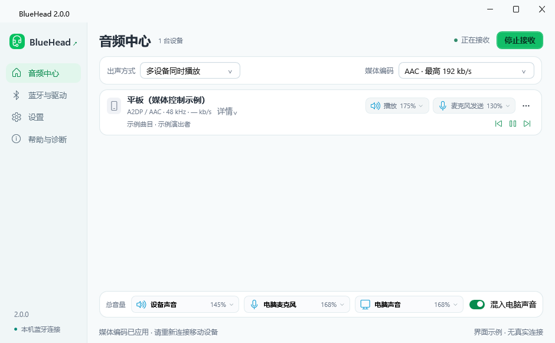

# BlueHead

**把 Windows 电脑变成蓝牙耳机：收听设备声音，把电脑麦克风发送回去。**

Free, open-source Bluetooth audio for Windows. Classic audio, LE Audio / LC3, broadcast reception and LHDC 5.0, with a native C/C++ audio engine. No shared Wi-Fi or mobile companion app required.

[下载 2.1.5](https://github.com/tingol666/BlueHead/releases/latest) · [使用指南](docs/UI_GUIDE.md) · [协议与兼容性](docs/COMPATIBILITY.md) · [源码构建](docs/BUILDING.md) · [反馈问题](https://github.com/tingol666/BlueHead/issues)



## 功能

- **媒体与双向语音**：在电脑听手机、平板等设备的音乐和视频；在支持蓝牙麦克风的通话、录音或录像应用中使用电脑麦克风。
- **多设备**：同时连接多个设备并混合播放，或一次听一台，停止传音后自动接替另一台正在播放的设备。
- **独立音量**：每台设备的播放与麦克风发送分别调节 0%–200%，另有设备声音、电脑麦克风、电脑声音三个总控，各自支持静音。
- **声音设备热切换**：接收中更换电脑耳机、扬声器、麦克风；默认输入输出自动跟随 Windows，不需要重新连接蓝牙。
- **电脑声音混合**：把其他应用声音与电脑麦克风合并发送。默认在系统采集阶段排除 BlueHead；也可选择独立的播放设备作为来源，并检查是否会返送设备声音。
- **媒体控制**：AVRCP 曲目信息、上一曲／播放／暂停／下一曲，以及标准设备音量同步。
- **LE Audio 与广播**：LC3 单播媒体、双向语音、附近音频广播搜索、密码和节目选择；按适配器实际能力开放对应功能。
- **驱动管理**：程序内备份、切换、修复和恢复蓝牙驱动；状态提示给出具体操作，不在后台突然请求管理员授权。

## 为什么使用原生音频核心

BlueHead 的持续音频链路已从 Python 迁至 **C/C++**。Python 仍负责蓝牙信令与控制，实时 PCM 不再经过 Python 回调。

| 设计 | 作用 |
|---|---|
| 单一 USB/HCI 所有者 | 一个原生后台统一持有控制器、ACL/SCO/ISO、发送信用及节拍，避免多个模块竞争蓝牙设备 |
| 统一时间线，分方向时钟 | 接收、播放、麦克风与电脑声音各自匹配时钟；自适应缓冲、有界补偿和平滑恢复共同处理短缺口 |
| 原采样率、浮点 PCM | 保留解码细节；96 kHz LDAC、192 kHz LHDC 可到同率输出，必要 SRC 与微小漂移匹配合并，减少重复重采样和量化 |
| 有界实时工作 | 端点准备与提交在控制线程，回调不打开设备、不做磁盘操作或无界搜索；已建立的音频流可跨越 Python 阻塞 |
| 故障隔离与过期保护 | LDAC/LHDC 解码进程与传输所有者分离；旧连接、迟到事件和过期音频不能重新打开旧路由 |
| 音质与连续性共同验证 | 使用逐样本／频率参考、静音与弱信号对照、原生线程阻塞、抖动丢包及独立时钟模型验证软件行为 |

程序不会通过悄悄降低已选编码质量或无限增加缓冲掩盖传输问题。软件处理延迟、缓冲配置和无线端到端延迟是不同指标。设计见 [架构](docs/ARCHITECTURE.md)、[音质契约](docs/AUDIO_FIDELITY.md)、[异常恢复](docs/RECOVERY.md)。

## 第一次使用

运行环境：**Windows 10 / 11 x64**，.NET Framework 4.8 / 4.8.1。完整包包含控制后台及原生依赖，无需另装 Python 或现代 .NET Desktop Runtime。电脑声音混合要求 Windows build 20348+，通常使用 Windows 11。

1. 从 [Releases](https://github.com/tingol666/BlueHead/releases/latest) 下载安装版或绿色版。绿色版完整解压到新文件夹，运行根目录 `BlueHead.exe`，不要只复制一个 EXE。
2. 首页选择 **蓝牙使用方式**：

   | 方式 | 适合的用途 | 影响 |
   |---|---|---|
   | **Windows 共用（基础）** | 只收听设备媒体，保留系统蓝牙键鼠、耳机 | 沿用 Windows 驱动；不提供 BlueHead 的麦克风、编码选择和专用混音 |
   | **BlueHead 专用（进阶）** | 电脑麦克风、多设备、高级媒体编码、LE Audio 和广播 | 所选适配器切换为 WinUSB，由 BlueHead 独占；它原有的系统蓝牙连接会断开 |

3. 选择进阶模式后，按 **蓝牙驱动设置** 页从上到下选择电脑蓝牙设备、查看影响，在页底右侧点击 **备份并启用专用蓝牙**。操作完成才保存新方式；取消不会只改变选项，完成后也不会自动开始接收。
4. **进阶模式**：回音频中心点右上角 **开始接收**，再在手机／平板的蓝牙设置中连接界面显示的电脑耳机名称。**基础模式**：先在电脑 Windows 蓝牙设置中添加并配对设备，回 BlueHead 点 **开始接收**，再在设备上播放媒体。
5. 点击底部音量块调音量和选择声音设备。设备卡片显示实际协议、采样率、码率；“实时详情”查看实际接收速率、缓冲和恢复计数。

**专用模式会使所选适配器不再提供 Windows 蓝牙；若没有其它系统适配器，Windows 蓝牙开关会消失。** 需要保留蓝牙键鼠时，使用基础模式或单独准备一个受支持的 USB 蓝牙适配器。恢复时在同一页点击 **恢复 Windows 蓝牙**。

关闭窗口默认留在托盘；单击托盘图标显示窗口，完全退出请右键托盘 → **退出**。更多操作见 [界面指南](docs/UI_GUIDE.md) 和 [音量、采集与实时详情](docs/AUDIO_CONTROLS.md)。

## 协议与兼容范围

| 项目 | 已实现范围 |
|---|---|
| 经典媒体 A2DP | SBC、AAC、aptX、aptX HD；自动模式优先协商已启用的高清编码 |
| LDAC | 按需开启的实验性独立解码器，44.1/48/88.2/96 kHz |
| LHDC 5.0 | 原生 44.1/48/96/192 kHz、16/24-bit 立体声解码，每设备进程隔离 |
| HFP 语音 | CVSD 8 kHz、mSBC 16 kHz、LC3-SWB 32 kHz；双向麦克风、录音／录像应用路由 |
| LE Audio / LC3 | BAP 单播接收与麦克风发送；7.5/10 ms、单／双声道接收；PACS、ASCS、CAS、VCS、MICS |
| 音频广播接收 | BAP 广播、BASS/PAST、公开／带密码广播、节目选择、单 BIS 或分离立体声 |
| 标准平台音频 | iPhone/iPad 的 AAC/SBC、HFP 和 AVRCP；Android、HarmonyOS、Windows 等以实际开放的协议和应用路由为准 |

首页媒体编码右侧的设置按钮统一管理 **优先 LE Audio / LC3／仅经典蓝牙**、**允许的经典编码**和**首选编码**；连接偏好也可在应用设置的 LE Audio 开关旁修改。设置自动保存。每台设备的 **“…” → 编码与音质** 可在本次连接中单独调整双方支持的编码、采样率及可协商参数，失败时尝试恢复原格式，不重启其它设备。实际协议、码率与回退原因以界面为准。详见 [编码与连接策略](docs/CODEC_POLICY.md)、[LE Audio / LHDC](docs/LE_AUDIO.md)。

蓝牙版本号不能保证 ISO、LE Audio 或特定编码能力。实际可用功能由适配器、USB 传输、固件和对端共同决定；未支持的方向不会被伪报为可用。多路高清媒体可能超过无线带宽，需要时可手动选 AAC 或单设备自动接替。

同一时间向一个设备发送电脑麦克风，默认通话／语音保护会在使用麦克风时暂时限制其它连接。应用须支持并选择蓝牙麦克风。当前不提供广播发送、LC3plus/HR、aptX Adaptive/Lossless、LHDC 可选无损／AR／JAS／META 扩展或全部可选 GAF 应用角色，也不声明 Bluetooth 或编解码器产品认证。HFP LC3-SWB 与 LE Audio 是不同路径。

## 技术栈与上游基础

BlueHead 是 Windows 桌面程序、原生运行时及蓝牙控制服务的组合。它基于下列开源组件构建，并为桌面蓝牙耳机场景实现传输所有权、会话生命周期、实时音频调度、混音、恢复及驱动工作流。

| 组件 | 在 BlueHead 中的用途与工作 |
|---|---|
| **C# / WPF、[WPF UI](https://github.com/lepoco/wpfui)** | 紧凑桌面界面、托盘、设备与驱动管理；目标 .NET Framework 4.8 |
| **Python / [Google Bumble](https://github.com/google/bumble)** | 配对、服务发现、A2DP/HFP/AVRCP 与 LE 信令；持续音频改由原生后台处理 |
| **C/C++ / [libusb](https://github.com/libusb/libusb)** | 唯一 USB/HCI 所有者、ACL/SCO/ISO、原生期限与信用控制 |
| **[miniaudio](https://github.com/mackron/miniaudio) / WASAPI** | 仅构建 Windows 设备 I/O；BlueHead 自有浮点混音、热切换、时钟与采集桥接 |
| **[FFmpeg](https://ffmpeg.org/)、[Google liblc3](https://github.com/google/liblc3)** | 裁剪的音频编解码库，以及原生 HFP LC3-SWB / LE LC3 |
| **[libldacdec](https://github.com/hegdi/libldacdec)** | 有界浮点解码与进程隔离，修正静音尺度和精细反量化，保留原采样率 |
| **[LHDC-V5-Decoder](https://github.com/WillyBilly06/LHDC-V5-Decoder)** | 固定上游数学解码源码；增加完整帧校验、窗口／幅度校准、坏包恢复和每设备隔离 |
| **[SpeexDSP](https://gitlab.xiph.org/xiph/speexdsp)、[PipeWire](https://github.com/PipeWire/pipewire)、[SpanDSP](https://github.com/freeswitch/spandsp)** | 有状态 SRC、蓝牙时钟控制参考和可替换的语音丢包补偿 |
| **[libwdi](https://github.com/pbatard/libwdi)、Windows SetupAPI** | 精确设备实例、原驱动备份、WinUSB 切换、恢复与需要重启的状态处理 |

运行包不使用 PyAV、NumPy、sounddevice 或现代 .NET 自包含运行时。上游固定修订、原始摘要、修改说明和许可证保存在 `vendor/`、`licenses/` 与 [第三方说明](THIRD_PARTY_NOTICES.txt)，不会把第三方项目的算法宣称为原创。

## 源码与构建

```text
bluehead/    蓝牙信令、会话与应用控制，原生 RPC 接口
native/      原生传输、编解码、时间线、PCM、Windows 适配和产品诊断
desktop/     WPF 桌面、系统接口与独立驱动工具
vendor/      固定版本上游源码、摘要及构建适配记录
tools/       构建、依赖清点、打包与源码边界检查
docs/        使用、兼容性与设计说明
installer/   安装与卸载
licenses/    第三方许可证
```

按 [BUILDING](docs/BUILDING.md) 可从干净检出生成完整安装包。GitHub 与 Source ZIP 使用同一份公开源码清单，包含构建所需完整代码、资源和依赖材料；本地回归测试、开发探针、个人配对、设置、驱动备份、日志、工具链和构建缓存不进入公开树。内置离线诊断随产品保留，见 [诊断](docs/DIAGNOSTICS.md) 和 [验证方法](docs/TESTING.md)。

## 数据、恢复与许可

音频在本机处理，不录音、不上传；广播密码不持久保存。程序不附带厂商固件镜像，按需验证获取或从原厂驱动包提取，缓存后可离线使用。按物理适配器识别和检测能力，不依赖某个厂商型号。见 [固件与启动](docs/FIRMWARE.md)。

启动失败请到 **蓝牙驱动设置** 按状态处理；需要原厂初始化时，手动点击右下方 **修复专用蓝牙**。恢复驱动后若仍需系统初始化，会提示 **“驱动恢复完成，请重启电脑”**。独立恢复入口：`BlueHead.exe --recovery`。

安装器要求新的空目录，目前不支持覆盖安装。升级前从托盘退出并备份数据：绿色版为自身 `data/`，安装版为 `%LocalAppData%\BlueHead\data`。保留原驱动备份和固件缓存；不要混用不同版本程序文件。反馈请附版本、实际协商编码及复现步骤，勿公开配对密钥或真实设备地址。

BlueHead 使用 [Apache-2.0](LICENSE)，第三方组件遵循各自许可。本项目与 Microsoft、Google、Apple、Sony、Qualcomm 等公司无隶属或产品认证关系。
