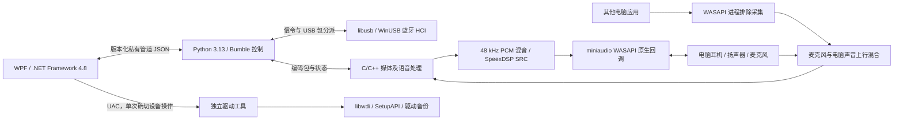

# 2.0.0 架构与恢复

本页描述待验收候选的当前架构。1.2.4及更早版本使用的PortAudio/PyAV路径属于历史实现，不能据此推断2.0.0的运行时依赖。

## 进程和边界

界面只处理显示和命令。音频不经过WPF或网络服务。后台stdin/stdout为继承的私有管道，JSON带协议与版本检查；不提供无认证的本机网络控制端口。

Python保留Bumble的蓝牙信令、USB包分派、异步会话和控制。原生化的是媒体和语音音频处理，不是整个蓝牙栈。压缩包及状态仍可能经过Python，不能称为完整链路零GIL或硬实时。

## 媒体与语音

媒体压缩包进入有界原生处理，完成RTP/媒体解包、codec状态和解码，再写入48kHz立体声混音核心。FFmpeg直接使用C API，仅发布avcodec、avutil和swresample，不再通过PyAV或NumPy搬运PCM。SBC、AAC、aptX、aptX HD保留现有兼容行为；LDAC仍是单独标明的实验功能。

HFP使用原生语音帧处理、重采样、增益及mSBC/LC3-SWB编解码。CVSD链路处理控制器提供的窄带PCM。H2/SCO分片、丢帧与PLC按对应codec处理，SpanDSP PLC保留为可独立替换的动态库；LC3实现固定到liblc3v1.1.3。一次只有一个语音发送对象。

挂断、暂停、配置切换、重连和关闭必须清除旧代次音频。解码失败、包丢失、缓冲不足和来源隔离分别计数，不把持续错误隐藏成正常播放。AAC流配置与编码状态恢复规则由媒体层负责，不能在每个坏包后盲目重置全部状态。

## 实时音频与设备

miniaudio0.11.25只启用WASAPI后端，播放和采集callback均为原生C函数，不进入Python。实时路径使用预分配缓冲、有界环形队列和原子参数；媒体mixer采用逐来源生产者同步与单渲染消费者，回调不等待全局混音互斥锁。

输出优先用48kHz共享流及Windows自动格式转换，保留1.2.4解决非48kHz输出周期停顿的路径。不修改系统设备格式。系统转换不被接受，或协商后发现通用内部SRC仍在改变采样率时，重新按端点时钟打开，使用已有固定状态SpeexDSP转换。不能假设所有端点都支持最低共享周期。

麦克风callback只写原生有界队列；非实时消费者在C中下混、转换成单声道S16，Python工作线程只搬运字节和会话路由。停止/溢出后的旧语音不得在新通道重放。语音与媒体分别预缓冲，设置值不等于端到端延迟。

Context拥有原生库引用、WASAPI上下文和所有流。COM及设备控制固定在持久daemon控制线程；正常关闭明确结束并join，但卡住的系统打开不能通过解释器退出时的隐式线程池join阻止进程退出。调用者等待真实操作结果，不用不透明超时误报回退后又发生晚提交。

输入输出按稳定IMMDevice ID识别，列表索引仅用于显示。候选设备先准备而不启动，停止旧消费者后才启动新消费者；失败保留或恢复原路由。设备变化后只重建需要更新的本机音频，不重建蓝牙连接。流关闭与采集读取/统计同步，ma_device_uninit完成回调退出后才释放原生状态；Context最后释放。

## 音量与AVRCP

本地接收增益、逐设备上行增益及三个总增益均为0–2。下行叠加播放总增益；上行为“实体麦克风×麦克风总增益 + 电脑声音×电脑声音总增益”，再乘目标设备上行增益。静音为零，超出可表示范围的混音需限幅。

AVRCP控制和元数据按蓝牙连接生命周期管理，曲目信息只进界面状态，不写原始日志。远端标准绝对音量为0–1，与0–2的接收增益分离；前者变化不能重写后者。未知播放状态不能猜测play/pause；不支持的操作禁用或明确报告拒绝。迟到事件不能重新创建设备卡片。

LC3-SWB是HFP的语音codec，不是LE Audio/BAP。协议实现与实际对端兼容、产品认证是不同事情。

## 电脑声音混合与隔离

原生WASAPI进程排除采集使用后台工作进程PID及其子进程树，要求Windows build20348+。渲染必须留在被排除的后台进程或子树；移到WPF进程会绕过排除边界。不能改成“全局loopback减去移动端PCM”，这无法保证无返送。

这一排除只针对数字回路，不能排除实体麦克风从空气中再次拾音。没有声学AEC。

## 驱动与退出

驱动工具独立运行，默认普通权限，仅确切的安装/备份/恢复操作请求UAC。保留USB HCI设备白名单、实例身份校验、适配器租约、受保护备份目录、原子恢复记录及失败回退，不按友好名称批量替换驱动。

.NET Framework兼容层保留既有SHA256恢复路径，参数经过Windows命令行引用，记录替换使用原子重命名/替换。桌面以Windows job object管理自己的后台进程树，超时与退出只清理该树，不按名称结束其它程序。独立恢复窗口不依赖蓝牙后台。
