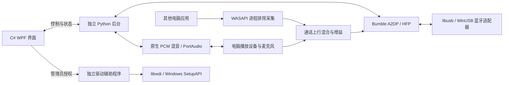

# 架构与恢复

桌面进程只处理界面和控制。它通过继承的私有 stdin/stdout 管道与接收后台交换版本化 JSON；音频不经过界面或网络连接。后台异常退出会显示错误，关闭界面时会请求后台释放连接与麦克风。

## 音频

媒体和通话分别预缓冲。默认通话 30 ms，媒体 60 ms；队列有时长上限。原生混音的渲染路径不分配内存，不等待互斥锁；发生竞争时输出静音并计数。输入写入、设备选择和诊断在回调之外管理。

媒体来源的持续时钟差通过限幅为 ±500 ppm 的连续补偿处理，使用预计算的 64 阶窗口 sinc 插值。通话保持其协商时钟，不启用此媒体补偿。麦克风待发送缓存按通话采样率控制时长，过量时保留最新语音。

PortAudio 初始化与所有设备控制在一个持久 COM 线程完成，音频回调不进入控制队列。原生 Core Audio 监视活动端点和默认角色变化，约两秒稳定后触发重新枚举；重新枚举前关闭所有自有流，再重建本机音频并按稳定端点 ID 恢复选择，蓝牙连接不重建。系统默认选择随系统变化，指定设备消失时回退默认。

输入、输出沿用事务式切换：先尝试打开候选端点，失败时保持原端点；启动新端点前停止旧消费者。挂断、重连、暂停和关闭会丢弃旧连接或旧代次的音频结果。AVDTP 恢复时重置 RTP 序列和非 AAC 预测器，AAC 保留 LATM StreamMuxConfig；aptX/HD 同步损坏时从真实编码码字中识别两轮奇偶同步周期，再从正确边界重建状态；不在每个新包到达时盲目重置。实验 LDAC 在现有隔离进程内重置状态，避免恢复时冷启动进程导致积压。

每设备下行增益同时作用于其媒体和通话声音，另叠加播放总增益。通话上行按“实体麦克风总增益 + 电脑声音总增益”混合，再乘当前设备的上行增益；所有增益为 0–2，0 为静音。峰值超出数字范围时按块限幅，避免饱和削波。每设备音量作为私有设置保留。

高级电脑声音源采用原生 C++ WASAPI `ActivateAudioInterfaceAsync` 进程排除模式，目标为后台工作进程 PID 及其子进程。电脑声音在系统混音阶段排除 BlueHead 渲染流；不采用“抓全局输出再减去手机 PCM”的方法。该捕获不依附特定播放端点，使用独立 MTA 线程和固定容量环形缓存，通话挂断、切换设备或关闭模式后停止采集。它不能排除实体麦克风从空气中再次拾到的声音。

实时码率按最近两秒收到的编码负载计算，停止数据后回落到零，不用编码器的标称值冒充实测。媒体去除 RTP/媒体封装；mSBC 去除 H2 帧头，CVSD 将主机 PCM 字节换算为空中语音负载。数值不包含蓝牙重传或无线物理层开销。共用 Windows 蓝牙模式无法取得该层统计，界面明确显示由系统管理。

## 驱动流程

只枚举具有 USB Bluetooth HCI 兼容标识的设备，操作时再核对设备实例。UI 为普通权限，辅助程序一次执行一个明确操作。

1. 在受管理员保护的 `%ProgramData%\BlueHead\Drivers` 创建恢复目录。
2. 导出并检查原驱动备份，记录设备实例和原始 INF。
3. libwdi 生成引用 Windows 自带 WinUSB 的设备 INF 和 catalog；不附带第三方内核驱动或旧版 Microsoft coinstaller。
4. 通过 SetupAPI 为指定设备绑定指定驱动，再检查设备服务和问题码。
5. 安装失败时尝试恢复，保存失败与恢复状态。需要重启时如实显示待重启状态。

恢复不是仅运行 `pnputil /add-driver`。它会暂存备份包并指定兼容驱动，将原驱动绑定到同一设备实例。此前由 Zadig 准备的适配器，可从兼容列表查找并备份已安装的原厂驱动。

驱动操作检查接收器占用，正常接收时拒绝更换。独立恢复窗口在后台不能启动时仍可用。卸载前检查恢复需求；恢复未完成则保留应用以供继续处理。

## 数据

绿色版检测 portable.flag 后使用程序目录内的 data；BLUEHEAD_DATA_DIR 环境变量优先。安装版默认使用 `%LocalAppData%\BlueHead\data` 保存设置、配对和有界日志。项目内启动脚本使用被 Git 忽略的 `local/data`，便于本机保留旧配对。恢复备份保存在 ProgramData，升级和卸载不删除它。

公开源码和程序包通过明确的文件列表生成，排除私有数据、原驱动备份、日志、转储和构建缓存。
