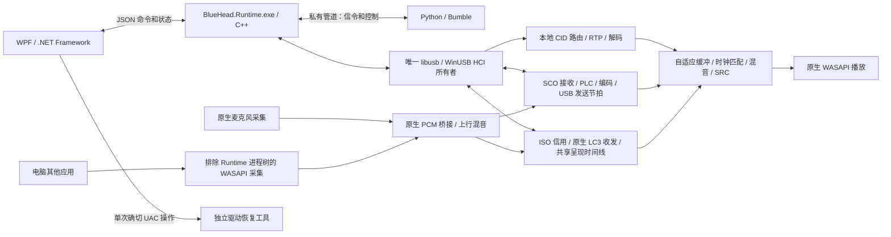

# 架构与所有权

持续音频收发和调度运行于 C/C++，Python 保留信令及应用控制。工程按所有权拆分组合入口、传输、音频图、设备控制和媒体工作线程。历史 Python 样本路径保留为离线对照及非生产入口；正式桌面以 C++ 后台作为入口，不在运行中悄悄回退到 Python 实时链路。

## 代码分层与依赖

| 层 | 位置 | 职责与限制 |
| --- | --- | --- |
| 组合入口 | `native/runtime/runtime_core.hpp` | `Core` 组合音频图与唯一 `Usb`；USB 先关闭并等待，再释放音频图 |
| 进程／控制接口 | `native/runtime/{application_host,rpc_server}.hpp` | 子进程、私有 RPC、命令边界；入口 `runtime_main.cpp` 只完成启动与退出 |
| 传输 | `native/transport/` | libusb/HCI 所有者、分片、信用与节拍；通过 `HciTarget` 访问音频，不持有编解码状态 |
| 音频图 | `native/runtime/audio_graph.hpp` | 来源／语音会话、路由、代次和增益；依赖 HCI 音频接口，不依赖 USB 实现 |
| 媒体来源 | `native/runtime/audio/media_worker.hpp` | 每来源队列、解码、期限、连续性与计数；只依赖 `MediaServices` 中的有限服务，不反向引用整个图或设备控制器 |
| LE 原生音频 | `native/runtime/audio/iso_{receiver,transmitter}.hpp` | 固定容量 ISO/LC3 队列、分离声道、呈现时钟、原生发送期限；复用现有音频图与端点 |
| LE 信令与服务 | `bluehead/le_audio/` | ASCS/PACS/CAS、VCS/MICS、BASS/PAST、广播生命周期与 scoped 原生路由；不访问 USB 或 PCM |
| 设备控制 | `native/runtime/audio/endpoint_actor.hpp` | 唯一 MTA 设备控制线程、候选提交、恢复退避、端点库存及 PCM 生产者桥接；不接触 USB 或语音编码器 |
| DSP 与编解码 | `native/audio/`、`native/codecs/` | float 混音、时钟、SRC、补偿及编解码；公开 C ABI 在 `native/include/` |
| Windows 适配 | `native/platform/windows/` | WASAPI、进程排除采集、启动器、原生异常诊断与 INF 模板 |
| 离线注入 | `native/testing/` | 合成回放与虚拟时钟；运行时注入命令必须显式启用 offline-test，不能打开真实设备 |
| Python 控制 | `bluehead/native_control/` | 分离 RPC 连接、Bumble 信令适配和带 lease 的音频控制；只传命令／压缩信令，不传 PCM |

`bluehead/native_runtime.py` 仅作稳定导入兼容层，所有类都重导出同一实现，不创建第二套客户端或全局所有者。应用内部使用 `native_control`。协议实现继续使用固定版本 Bumble，不为目录调整复制协议栈。

依赖检查会递归验证音频图／工作线程无法引入 libusb 实现，以及媒体工作线程无法反向依赖完整音频图或端点控制器。公开 C ABI、DLL 动态替换和 LGPL 边界保持不变。

DLL 引用在音频图中最先构造、最后释放；原生缓冲采用 RAII。部分初始化失败会先回收已启动的线程和设备，再释放缓冲与 DLL；错误退出不依赖构造函数完整执行。端点 actor 保留同一个设备控制线程，并未因拆分增加实时线程或 PCM 拷贝。

构建工具共享 `tools/native_build.py` 中的目录和工具链发现规则。`pyproject.toml` 是版本来源，`tools/sync_version.py` 生成 Python 与 MSBuild 常量；原生资源、握手和包元数据也读取该版本。源码发布边界与生成物规则集中在 `tools/finalize_release.py`，Git 索引通过 `tools/audit_sources.py` 同步检查。

## 进程和所有权

Runtime 是适配器唯一物理所有者，持有兼容旧版的 Local 租约及 Global 租约。Python 不再打开 libusb，也不创建专用模式的音频端点。Bumble 保留信令命令/ACL 的单一信用账本及响应匹配；Runtime 按原字节转送这些控制包，不伪造第二套信用。语音专用完成通知在原生层消化，SCO 由原生 USB 节拍发送。

注册后的媒体 CID 和语音 handle 在 HCI 到达时进入原生有界队列，其余信令通过受当前用户 ACL 保护、拒绝远程连接的随机命名管道交给 Bumble。生产管道不传 PCM。LDAC 与 LHDC 5.0 解码器按来源隔离到独立 C++ 子进程，只使用原生共享内存传递数据，不持有 USB 或声音设备；进程崩溃、超时和重置不能污染另一来源的解码状态。

WPF 只收发 JSON。Runtime 将普通命令交给 Python；总增益、麦克风总静音和停止先在原生层执行。Python 暂停时，已建立的音频链路继续运行；配对、HFP/AVDTP 重新协商及普通控制操作需要 Python 恢复，不能把这种隔离称为整个蓝牙栈原生化或硬实时保证。

## 媒体与语音

媒体压缩包进入有界原生处理，完成RTP/媒体解包、codec状态和解码，以协商采样率的 float PCM 写入对应来源环；原生混音器按端点采样率呈现，48k 仅是公共时间单位。FFmpeg直接使用C API，仅发布avcodec、avutil和swresample，不再通过PyAV或NumPy搬运PCM。SBC、AAC、aptX、aptX HD保留现有兼容行为；LDAC仍是单独标明的实验功能。

HFP使用原生语音帧处理、重采样、增益及mSBC/LC3-SWB编解码。CVSD链路处理控制器提供的窄带PCM。H2/SCO分片、丢帧与PLC按对应codec处理，SpanDSP PLC保留为可独立替换的动态库；LC3实现固定到liblc3v1.1.3。一次只有一个语音发送对象。

挂断、暂停、配置切换、重连和关闭必须清除旧代次音频。解码失败、包丢失、缓冲不足和来源隔离分别计数，不把持续错误隐藏成正常播放。AAC流配置与编码状态恢复规则由媒体层负责，不能在每个坏包后盲目重置全部状态。

## 实时音频与设备

miniaudio0.11.25只启用WASAPI后端，播放和采集callback均为原生C函数，不进入Python。实时路径使用预分配缓冲、有界环形队列和原子参数；媒体mixer采用逐来源生产者同步与单渲染消费者，回调不等待全局混音互斥锁。

输出优先采用端点实际共享采样率，必要采样率转换与小幅漂移匹配合并为一次有界 ASRC；系数、格式和内存在控制侧准备。96k LDAC 配合 96k 端点可直接保留原生 PCM。端点拒绝原生协商时才尝试 48k Windows 自动转换；不静默启用 miniaudio 通用 SRC，不修改系统格式。兼容入口仍保留固定状态 SpeexDSP。

麦克风 callback 只写原生有界队列并通知原生桥接线程；下混、原生采样率 float 桥接、上行混音和语音编码均在 C/C++ 中完成。语音在 8/16/32k 编码器原生域处理；仅整数编码边界量化，保留 48k 兼容 API。采集与编码通过原生事件唤醒，语音发送通过高精度定时器唤醒 libusb 事件线程。停止/溢出后的旧语音不得在新通道重放。语音与媒体分别预缓冲，设置值不等于端到端延迟。

Context 拥有原生库引用、WASAPI 上下文和所有流。COM 及设备控制由原生控制线程串行处理。准备阶段可取消，代号检查与指针提交处于同一事务；超时或挂断后的旧准备结果不能晚提交。正常关闭先结束并等待回调，再释放队列和 DLL。每个端点转换方案保留原生混音器引用；异常关闭先释放外层所有者时，存活回调只输出静音，最后一个方案退役后才释放底层存储。系统音频 API 长时间不返回时，独立看门狗终止自有后台进程；Windows job 关闭其子进程，独立驱动恢复工具仍可使用。

输入输出按稳定IMMDevice ID识别，列表索引仅用于显示。播放端先准备候选，停止旧消费者后才启动新消费者，避免两个消费者同时读取混音器。麦克风端先在共享 PCM 桥接锁外准备候选、转换系数及存储，准备期间旧输入继续工作；启动私有候选后，短事务验证任务代号、来源代次和转换方案版本，再一并发布格式及采集指针。提交繁忙会立即退出共享锁，重置候选的私有采集队列后重试，避免长时间准备积累的旧声音被发布。取消、准备失败或旧方案失效均不能晚提交；资源释放和重试等待留在控制侧。设备变化后只重建需要更新的本机音频，不重建蓝牙连接。流关闭与采集读取/统计同步，ma_device_uninit完成回调退出后才释放原生状态；Context最后释放。

`native/include/audio_format_plan.h` 的准备／提交／退役接口区分可分配、可等待的控制操作与有界提交。转换方案持有所有者引用；提交只尝试取得所需锁，验证单调递增的来源及路由修订号，等待中的读者会使本次提交返回繁忙，不能在共享桥接内等待回调。相同采样率的普通操作不清空 PCM；显式更换输入才退役旧来源。退役存储及系数在提交锁外释放，槽位复用不能使旧方案重新生效。

播放、麦克风和电脑声音采集使用相同的状态发布事务：端点名称、重试选择及成功结果节点先准备，实际路由提交后只交换已经拥有的状态。提交后的状态记录不再分配，不能把“已切换成功”误报为失败。诊断缓存更新独立捕获分配异常，保留旧缓存及数值错误计数，不改变已提交结果或停止音频线程。

经典语音发送队列使用编码开始时刻记录音频年龄，延迟完成的编码不能获得新的发送期限。唯一 HCI 发送消费者在取走数据前检查代次、格式、90 ms 时效和整次请求所需的可用字节，预检不足不消耗有效前缀。完全未发送的旧帧会丢弃；已经提交部分字节的同一帧先完整结束，避免把不同 H2 帧拼接。改变语音代次则直接退役旧尾部。检查使用固定容量队列，过期、旧代次和接收损坏分别计数，不增加 USB/HCI 所有者。

## 音频连续性

每个媒体/语音来源分别保存缓冲、时间线和时钟状态。到达抖动决定有限的自适应目标，独立采样时钟由 PipeWire 思路的平滑控制器匹配。正常收包不复制或跳过相关波形追赶目标；波形补偿仅用于真正缺失的音频，并验证两声道去直流后的相关性，恢复时有限合并。

媒体 PCM 环旁的恢复标记共享同一发布／读取游标；未知时长之后的真实音频不能被独立的截止欠账误删。
正常播放不扫描标记，回调不分配或等待锁。来源工作线程只获取保守的库存／截止快照，
消费者独占实际呈现与过期操作，不采用两个线程分别扣减的补偿信用。估计或省略的区间退出到达差分，
重新锚定后才继续学习抖动。独立解码进程通过有版本和大小校验的共享内存传递真实位置的标记，
不根据统计差值猜测 PCM 布局。

生产混音器按采样帧连续处理增益及过载保护：5 ms 增益渐变、立即静音、约 1.5 ms 双声道联动前瞻（按实际输出采样率换算）。每个来源拥有自己的待输出音频，清空或复用一路不清空其他来源。正常幅度保留原信号，限幅释放使用更高精度控制状态以恢复到原增益。音质契约与耳机参考设计见 [AUDIO_QUALITY](AUDIO_QUALITY.md)。

完整连续包以实际解码帧数推进时间线，只有明确序号缺口或已归属的损坏负载才能触发缺口补偿。编码层独占协议校验、分片和 SDU 归属，共享 `native/audio/audio_gap_policy.h` 区分已知损坏帧数、未知单元数、历史估计和省略证据。固定容量时长分布只学习完整成功单元，不能用上一大包放大后续缺口。缺口处理接口不接收 RTP 时间戳，也不由估计大小重置解码器或清空有效 PCM；生命周期、新流与实际解码失败分别恢复。短缺口优先按相关历史做最多约 20 ms 的衰减续接；无法可靠预测的瞬态快速淡出，恢复的真实 PCM 做短交叉淡化。持续饥饿及严重的持续部分供给有独立补偿预算。

波形预测预算与缺口时长判断不同：正常 AAC/aptX HD 单包可长于 20 ms，不能因预测已淡出就把有依据的剩余缺帧时间裁掉。未知时长仍只是估计；超出有界预算时消费并记录未投放证据，不造长静音，不把省略量藏到下一包，也不能以此清除已经排队的真实声音。

显式暂停清除旧 PCM 和到达抖动历史，不能把一次长通话误算为无线抖动。RTP SSRC、会话代号、输入租约及分片代号阻止旧数据串入新会话；RTP 通道关闭即释放旧 CID。真实解码帧、丢包、补偿帧、短缺口、重新缓冲及队列丢弃分别计数。

这些策略不能恢复已经丢失的原始信号，也不等同蓝牙端到端延迟实测。复现方法见 [连续性验证](AUDIO_CONTINUITY.md)。

## 音量与AVRCP

本地接收增益、逐设备上行增益及三个总增益均为0–2。下行叠加播放总增益；上行为“实体麦克风×麦克风总增益 + 电脑声音×电脑声音总增益”，再乘目标设备上行增益。静音为零，超出可表示范围的混音需限幅。

AVRCP控制和元数据按蓝牙连接生命周期管理，曲目信息只进界面状态，不写原始日志。远端标准绝对音量为0–1，与0–2的接收增益分离；前者变化不能重写后者。未知播放状态不能猜测play/pause；不支持的操作禁用或明确报告拒绝。迟到事件不能重新创建设备卡片。

LC3-SWB 是 HFP 语音编码；LE Audio / LC3 走独立 BAP/ISO 路径。新服务、广播、原生连接代次、时钟及验证范围见 [LE_AUDIO](LE_AUDIO.md)。协议实现、实际对端兼容与产品认证分别记录。

## 电脑声音混合与隔离

原生WASAPI进程排除采集使用后台工作进程PID及其子进程树，要求Windows build20348+。渲染必须留在被排除的后台进程或子树；移到WPF进程会绕过排除边界。不能改成“全局loopback减去移动端PCM”，这无法保证无返送。

这一排除只针对数字回路，不能排除实体麦克风从空气中再次拾音。没有声学AEC。

## 驱动与退出

驱动工具独立运行，默认普通权限，仅确切的安装/备份/恢复操作请求UAC。保留USB HCI设备白名单、实例身份校验、适配器租约、受保护备份目录、原子恢复记录及失败回退，不按友好名称批量替换驱动。

.NET Framework兼容层保留既有SHA256恢复路径，参数经过Windows命令行引用，记录替换使用原子重命名/替换。桌面以Windows job object管理自己的后台进程树，超时与退出只清理该树，不按名称结束其它程序。独立恢复窗口不依赖蓝牙后台。

## 控制器初始化与驱动恢复

2.1.3 将物理身份、能力检测、厂商初始化与固件信任拆分为 native/controller/ 和 native/firmware/。厂商后端只借用唯一 USB 所有者的命令、事件和进度端口；初始化完成后才开放运行期 HCI。独立固件获取进程不持有 USB，不进入实时音频线程。Windows 平台层按真实物理目标选择原驱动、保存恢复阶段，并通过单次交接策略处理原厂引导；界面以纯状态策略统一不同页面的下一步。详见 [控制器兼容架构](COMPATIBILITY.md) 与 [固件与启动](FIRMWARE.md)。

## 跨线程状态快照

桌面命令来自控制进程的 stdin 线程，LE 服务、连接、任务和异步锁属于 Receiver 循环。增益、隐私通知和实时状态读取通过同一个受管理的控制入口回到所属循环。界面轮询合并正在执行的旧请求，快照中的广播计数同时核对会话和原生 token，旧回复不能标记新选择。关闭先取消受管理控制任务，再回收服务、路由与唯一传输所有者。
