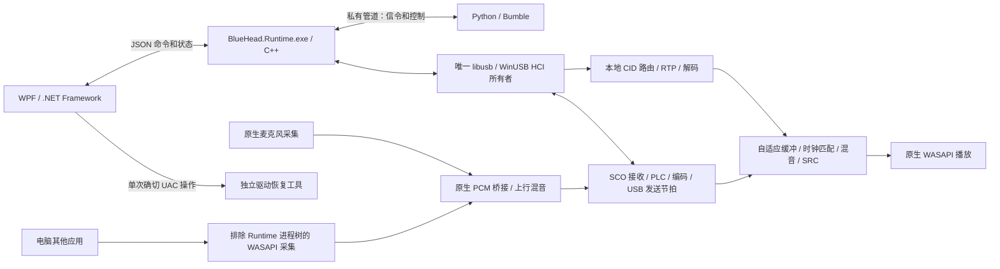

# 2.1.2 架构与恢复

持续音频收发和调度运行于 C/C++，Python 保留信令及应用控制。工程按所有权拆分组合入口、传输、音频图、设备控制和媒体工作线程。历史 Python 样本路径保留为离线对照及非生产入口；正式桌面以 C++ 后台作为入口，不在运行中悄悄回退到 Python 实时链路。

## 代码分层与依赖

| 层 | 位置 | 职责与限制 |
| --- | --- | --- |
| 组合入口 | `native/runtime/runtime_core.hpp` | `Core` 组合音频图与唯一 `Usb`；USB 先关闭并等待，再释放音频图 |
| 进程／控制接口 | `native/runtime/{application_host,rpc_server}.hpp` | 子进程、私有 RPC、命令边界；入口 `runtime_main.cpp` 只完成启动与退出 |
| 传输 | `native/transport/` | libusb/HCI 所有者、分片、信用与节拍；通过 `HciTarget` 访问音频，不持有编解码状态 |
| 音频图 | `native/runtime/audio_graph.hpp` | 来源／语音会话、路由、代次和增益；依赖 HCI 音频接口，不依赖 USB 实现 |
| 媒体来源 | `native/runtime/audio/media_worker.hpp` | 每来源队列、解码、期限、连续性与计数；只依赖 `MediaServices` 中的有限服务，不反向引用整个图或设备控制器 |
| 设备控制 | `native/runtime/audio/endpoint_actor.hpp` | 唯一 MTA 设备控制线程、候选提交、恢复退避、端点库存及 PCM 生产者桥接；不接触 USB 或语音编码器 |
| DSP 与编解码 | `native/audio/`、`native/codecs/` | float 混音、时钟、SRC、补偿及编解码；公开 C ABI 在 `native/include/` |
| Windows 适配 | `native/platform/windows/` | WASAPI、进程排除采集、启动器、原生异常诊断与 INF 模板 |
| 离线注入 | `native/testing/` | 合成回放与虚拟时钟；运行时注入命令必须显式启用 offline-test，不能打开真实设备 |
| Python 控制 | `bluehead/native_control/` | 分离 RPC 连接、Bumble 信令适配和带 lease 的音频控制；只传命令／压缩信令，不传 PCM |

`bluehead/native_runtime.py` 仅作稳定导入兼容层，所有类都重导出同一实现，不创建第二套客户端或全局所有者。应用内部使用 `native_control`。协议实现继续使用固定版本 Bumble，不为目录调整复制协议栈。

依赖检查会递归验证音频图／工作线程无法引入 libusb 实现，以及媒体工作线程无法反向依赖完整音频图或端点控制器。公开 C ABI、DLL 动态替换和 LGPL 边界保持不变。

DLL 引用在音频图中最先构造、最后释放；原生缓冲采用 RAII。部分初始化失败会先回收已启动的线程和设备，再释放缓冲与 DLL；错误退出不依赖构造函数完整执行。端点 actor 保留同一个设备控制线程，并未因拆分增加实时线程或 PCM 拷贝。

构建工具共享 `tools/native_build.py` 中的目录和工具链发现规则。`pyproject.toml` 是版本来源，`tools/sync_version.py` 生成 Python 与 MSBuild 常量；原生资源、握手和包元数据也读取该版本。源码发布边界与生成物规则集中在 `tools/finalize_release.py`，Git 索引通过 `tools/audit_sources.py` 同步检查。

## 进程和所有权

Runtime 是适配器唯一物理所有者，持有兼容旧版的 Local 租约及 Global 租约。Python 不再打开 libusb，也不创建专用模式的音频端点。Bumble 保留信令命令/ACL 的单一信用账本及响应匹配；Runtime 按原字节转送这些控制包，不伪造第二套信用。语音专用完成通知在原生层消化，SCO 由原生 USB 节拍发送。

注册后的媒体 CID 和语音 handle 在 HCI 到达时进入原生有界队列，其余信令通过受当前用户 ACL 保护、拒绝远程连接的随机命名管道交给 Bumble。生产管道不传 PCM。LDAC 实验解码器仍隔离到独立 C++ 子进程，只使用原生共享内存传递数据，不持有 USB 或声音设备。

WPF 只收发 JSON。Runtime 将普通命令交给 Python；总增益、麦克风总静音和停止先在原生层执行。Python 暂停时，已建立的音频链路继续运行；配对、HFP/AVDTP 重新协商及普通控制操作需要 Python 恢复，不能把这种隔离称为整个蓝牙栈原生化或硬实时保证。

## 媒体与语音

媒体压缩包进入有界原生处理，完成RTP/媒体解包、codec状态和解码，以协商采样率的 float PCM 写入对应来源环；原生混音器按端点采样率呈现，48k 仅是公共时间单位。FFmpeg直接使用C API，仅发布avcodec、avutil和swresample，不再通过PyAV或NumPy搬运PCM。SBC、AAC、aptX、aptX HD保留现有兼容行为；LDAC仍是单独标明的实验功能。

HFP使用原生语音帧处理、重采样、增益及mSBC/LC3-SWB编解码。CVSD链路处理控制器提供的窄带PCM。H2/SCO分片、丢帧与PLC按对应codec处理，SpanDSP PLC保留为可独立替换的动态库；LC3实现固定到liblc3v1.1.3。一次只有一个语音发送对象。

挂断、暂停、配置切换、重连和关闭必须清除旧代次音频。解码失败、包丢失、缓冲不足和来源隔离分别计数，不把持续错误隐藏成正常播放。AAC流配置与编码状态恢复规则由媒体层负责，不能在每个坏包后盲目重置全部状态。

## 实时音频与设备

miniaudio0.11.25只启用WASAPI后端，播放和采集callback均为原生C函数，不进入Python。实时路径使用预分配缓冲、有界环形队列和原子参数；媒体mixer采用逐来源生产者同步与单渲染消费者，回调不等待全局混音互斥锁。

输出优先采用端点实际共享采样率，必要采样率转换与小幅漂移匹配合并为一次有界 ASRC；系数、格式和内存在控制侧准备。96k LDAC 配合 96k 端点可直接保留原生 PCM。端点拒绝原生协商时才尝试 48k Windows 自动转换；不静默启用 miniaudio 通用 SRC，不修改系统格式。兼容入口仍保留固定状态 SpeexDSP。

麦克风 callback 只写原生有界队列并通知原生桥接线程；下混、原生采样率 float 桥接、上行混音和语音编码均在 C/C++ 中完成。语音在 8/16/32k 编码器原生域处理；仅整数编码边界量化，保留 48k 兼容 API。采集与编码通过原生事件唤醒，语音发送通过高精度定时器唤醒 libusb 事件线程。停止/溢出后的旧语音不得在新通道重放。语音与媒体分别预缓冲，设置值不等于端到端延迟。

Context 拥有原生库引用、WASAPI 上下文和所有流。COM 及设备控制由原生控制线程串行处理。准备阶段可取消，代号检查与指针提交处于同一事务；超时或挂断后的旧准备结果不能晚提交。正常关闭先结束并等待回调，再释放队列和 DLL。每个端点转换方案保留原生混音器引用；异常关闭先释放外层所有者时，存活回调只输出静音，最后一个方案退役后才释放底层存储。系统音频 API 长时间不返回时，独立看门狗终止自有后台进程；Windows job 关闭其子进程，独立驱动恢复工具仍可使用。

输入输出按稳定IMMDevice ID识别，列表索引仅用于显示。新设备先准备而不启动，停止旧消费者后才启动新消费者；失败保留或恢复原路由。设备变化后只重建需要更新的本机音频，不重建蓝牙连接。流关闭与采集读取/统计同步，ma_device_uninit完成回调退出后才释放原生状态；Context最后释放。

## 音频连续性

每个媒体/语音来源分别保存缓冲、时间线和时钟状态。到达抖动决定有限的自适应目标，独立采样时钟由 PipeWire 思路的平滑控制器匹配。正常收包不复制或跳过相关波形追赶目标；波形补偿仅用于真正缺失的音频，并验证两声道去直流后的相关性，恢复时有限合并。

生产混音器按采样帧连续处理增益及过载保护：5 ms 增益渐变、立即静音、约 1.5 ms 双声道联动前瞻（按实际输出采样率换算）。每个来源拥有自己的待输出音频，清空或复用一路不清空其他来源。正常幅度保留原信号，限幅释放使用更高精度控制状态以恢复到原增益。音质契约与耳机参考设计见 [AUDIO_QUALITY](AUDIO_QUALITY.md)。

RTP 时间戳用于识别丢失时长。短缺口优先按相关历史做最多约 20 ms 的衰减续接；无法可靠预测的瞬态快速淡出，恢复的真实 PCM 做短交叉淡化。到达侧仅补不足的尾部，持续缺失才进入一次预缓冲；严重的持续部分供给也有补偿预算。SCO 定时缺口最多补 8 帧（60 ms），随后等待真实数据恢复，不无限生成语音。

预测预算不限制缺失时间线本身：正常 AAC/aptX HD 单包可长于 20 ms，必须保留完整缺失时长。预测淡出后的剩余部分为静音，不能直接删除样本导致时钟债务；大于 200 ms 的媒体跳转另作流中断处理。

显式暂停清除旧 PCM 和到达抖动历史，不能把一次长通话误算为无线抖动。RTP SSRC、会话代号、输入租约及分片代号阻止旧数据串入新会话；RTP 通道关闭即释放旧 CID。真实解码帧、丢包、补偿帧、短缺口、重新缓冲及队列丢弃分别计数。

这些策略不能恢复已经丢失的原始信号，也不等同蓝牙端到端延迟实测。复现方法见 [连续性验证](AUDIO_CONTINUITY.md)。

## 音量与AVRCP

本地接收增益、逐设备上行增益及三个总增益均为0–2。下行叠加播放总增益；上行为“实体麦克风×麦克风总增益 + 电脑声音×电脑声音总增益”，再乘目标设备上行增益。静音为零，超出可表示范围的混音需限幅。

AVRCP控制和元数据按蓝牙连接生命周期管理，曲目信息只进界面状态，不写原始日志。远端标准绝对音量为0–1，与0–2的接收增益分离；前者变化不能重写后者。未知播放状态不能猜测play/pause；不支持的操作禁用或明确报告拒绝。迟到事件不能重新创建设备卡片。

LC3-SWB是HFP的语音codec，不是LE Audio/BAP。协议实现与实际对端兼容、产品认证是不同事情。

## 电脑声音混合与隔离

原生WASAPI进程排除采集使用后台工作进程PID及其子进程树，要求Windows build20348+。渲染必须留在被排除的后台进程或子树；移到WPF进程会绕过排除边界。不能改成“全局loopback减去移动端PCM”，这无法保证无返送。

这一排除只针对数字回路，不能排除实体麦克风从空气中再次拾音。没有声学AEC。

## 驱动与退出

驱动工具独立运行，默认普通权限，仅确切的安装/备份/恢复操作请求UAC。保留USB HCI设备白名单、实例身份校验、适配器租约、受保护备份目录、原子恢复记录及失败回退，不按友好名称批量替换驱动。

.NET Framework兼容层保留既有SHA256恢复路径，参数经过Windows命令行引用，记录替换使用原子重命名/替换。桌面以Windows job object管理自己的后台进程树，超时与退出只清理该树，不按名称结束其它程序。独立恢复窗口不依赖蓝牙后台。

## Intel 引导与驱动恢复

2.1.2 的 Intel RAM 固件初始化由唯一 USB 所有者执行，完成后才开放运行期 HCI 信令；不让 Bumble 和引导器同时记账。固件下载以状态轮询与可取消等待接入应用，驱动操作与普通接收启动互斥。原厂驱动绑定后还需按实际设备实例检查 Windows 蓝牙无线电，已恢复但无法就绪时提示重启电脑。范围与状态边界见 [INTEL_FIRMWARE.md](INTEL_FIRMWARE.md)。
