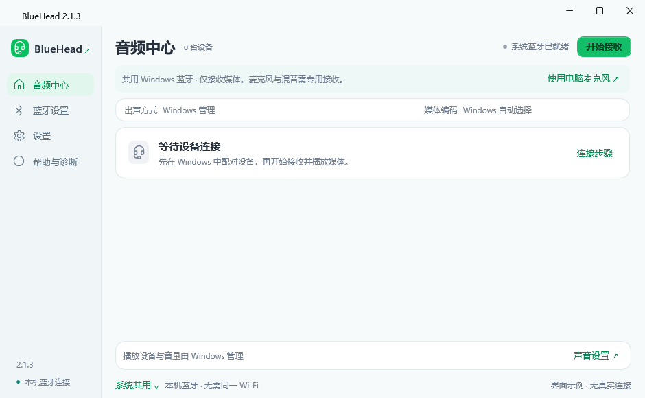
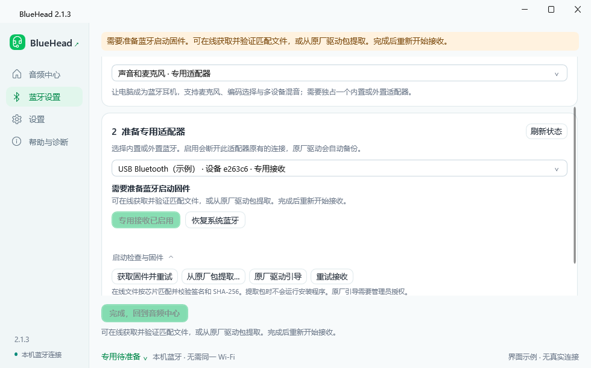

# 2.1.3界面与操作

本页介绍 BlueHead 2.1.3 的界面与常用操作。下图使用演示设备与曲目。

## 开始接收

首次使用从首页“设置蓝牙接收”进入“蓝牙设置”，先选需要的功能，再按当前适配器状态准备。选择接收方式只改变使用意图，不会直接换驱动；尚未准备时，首页明确显示下一步。

- **声音和麦克风 · 专用适配器**：支持蓝牙麦克风、媒体编码选择及多设备混音，需独占一个内置或外置适配器。启用时自动备份原驱动，该适配器原有的耳机、键鼠连接会断开。
- **只收听媒体 · 共用 Windows 蓝牙**：沿用系统驱动，保留 Windows 的其他蓝牙连接。先在 Windows 配对移动设备；媒体编码、播放设备与音量由系统管理。电脑麦克风与混音需切换专用接收。

“完成，回到音频中心”固定在蓝牙页底部；只有当前方式已准备好才可完成。正在接收时，先点“停止接收以切换”，再更改方式或驱动。

专用接收准备好后，回到首页点击“开始接收”，在移动设备蓝牙列表连接显示的名称；共用方式则先在 Windows 配对，再开始接收。媒体和语音开关由移动系统提供，录音/录像应用是否使用蓝牙麦克风也由应用决定。

## 首页入口

| 入口 | 用途 |
|---|---|
| 接收状态与开始/停止 | 同排显示是否已准备、正在接收或停止 |
| 出声方式 | 多设备同时播放，或单设备自动接替 |
| 媒体编码 | 默认优先高清；应用变更后重新连接，语音期间不会重启 |
| 名称后的当前播放/切换播放 | 单设备模式下主动选择来源 |
| 设备“播放”音量按钮 | 该设备在电脑播放的接收增益0%–200% |
| 设备“麦克风发送”按钮 | 混合后发送到该设备的上行增益0%–200% |
| 协议/采样率/码率后的详情 | 数据弹层，含接收统计、语音及AVRCP详情 |
| 曲名旁媒体按钮 | 上一曲、播放/暂停、下一曲，控制该设备播放器 |
| 底部设备声音 | 接收播放总增益与电脑输出设备选择 |
| 底部电脑麦克风 | 实体麦克风总增益与输入设备选择 |
| 混入电脑声音 | 开启后显示第三路电脑声音总控，合并发送其他电脑应用声音 |

上述编码、混音与本地增益控制用于专用接收。共用方式在首页、设置与帮助显示对应说明，并提供切换入口和 Windows 设置入口，不显示无效的音量或语音控制。底部模式入口可随时查看当前方式。

设备名与协议仍为紧凑两行，右侧音量按两行整体居中。AVRCP连接后才显示一条22px曲目/控制行；没有该能力的设备不占这一行。曲名、长设备名省略显示，悬停看详情。按钮带工具提示和无障碍名称，支持键盘焦点。

AVRCP只按对端报告的播放状态显示明确“播放”或“暂停”。未知状态时中央按钮禁用，不猜测toggle；对端不支持的操作禁用。曲名、专辑、播放位置和标准设备音量在详情中查看；对端未报告时显示未知。

## 音量与声音设备

每个音量按钮有名称、图标、百分比及下拉箭头。展开后可拖动0%–200%滑块、静音/取消静音、恢复100%。取消静音恢复此前数值。底部播放和麦克风弹层还可切换电脑设备；选择“默认…自动跟随”时跟随Windows变化。

AVRCP标准设备音量为0%–100%，与这里的接收增益分开；远端音量同步不会把本地增益改回100%。本版只在详情显示标准音量，不增加另一个容易混淆的滑块。

“混入电脑声音”关闭时有两个总控，开启时显示第三个。电脑麦克风弹层的“暂停发送到设备”会同时暂停实体麦克风及电脑声音发送；单路静音只影响对应音量。整体暂停在接收按钮旁显示“发送暂停”。详见[AUDIO_CONTROLS](AUDIO_CONTROLS.md)。

## 多设备与编码

当前设备主动暂停或不再传包后，单设备模式会接替仍连接且已请求播放的来源。音频中的安静段落不作为暂停；用户主动暂停的来源不应自动恢复。语音优先，结束后留媒体恢复期。设备名称后的按钮可主动切换。

高清并发持续不稳时，选择AAC并应用重连，必要时改最高192kb/s。AAC档位为协商上限，实际值以设备卡片为准；SBC不保证必然更低。受损来源可能暂时隔离并提示，不能以碎片声音混入正常来源。该提示不改用户音量。

## 其他设置与恢复

常用设置保留名称、蓝牙语音、托盘与启动；缓冲和最大设备数放二级高级音频设置，入口为明显整行。窗口按显示器工作区和DPI适配，保留手动缩小尺寸。

弹层点外部或Esc关闭；换页、移动/缩放窗口也关闭旧弹层。窗口关闭默认留在托盘，完全退出需托盘右键“退出”。

恢复系统蓝牙前先停止接收，到“蓝牙设置”选择正确适配器。界面分别显示想使用的接收方式与适配器的实际状态：

- 系统驱动正常时显示“已在使用系统蓝牙”，不能再次恢复；即使原厂备份仍保留，也不会因此开放重复恢复。
- 已启用专用接收时不允许重复启用；固件检查和初始化在“开始接收”中自动完成。
- 恢复当前接收适配器成功后，自动切换到系统共用方式，并同步首页、设置与帮助；恢复另一个适配器不会改变仍可用的专用接收。
- 原厂驱动已恢复但尚未完成初始化时，明确提示“驱动恢复完成，请重启电脑”，不再诱导重复更换驱动。
- 共用方式若仍只有专用适配器，会引导先恢复系统蓝牙；已有另一块可用系统适配器时可直接使用。

每次开始接收或执行驱动操作前重新读取状态；设备断开、状态检查失败或目标变化时要求检查后继续。驱动更换请求 Windows 管理员授权，取消不会改变所选方式或假报成功。原驱动备份保留在受保护的系统目录。

独立恢复入口为`BlueHead.exe --recovery`；使用相同的恢复状态规则，后台无法启动时仍可运行。

## 启动需要额外准备时

首页会显示“检查蓝牙启动”，点击直达对应适配器的“启动检查与固件”。根据当前原因提供“获取固件并重试”“从原厂包提取”“原厂驱动引导”或重试；签名错误不会继续加载。原厂引导会暂时交给 Windows 初始化，切回专用后复核；无法保留固件时恢复系统蓝牙。需要重启时按明确提示重启，无需重复恢复。

多个同型号适配器用名称和端口区分；失去已保存的物理设备不会随便接管另一台。仅媒体能力会在本次接收中说明并禁用麦克风操作，原有音质、增益和语音偏好保留。详情见 [固件与启动](FIRMWARE.md)。

