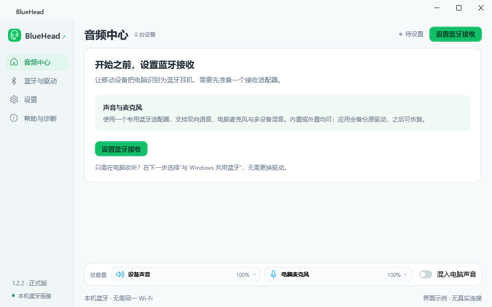
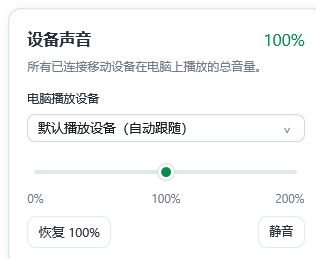

# 界面与操作

首页把“正在接收”与开始／停止按钮放在同一行，出声方式与媒体编码并排。设备采用紧凑两行：上方名称与播放标记相邻，下方协议、采样率、实测码率与“详情”相邻。右侧播放、麦克风发送两个音量入口按这两行整体垂直居中。绿色情态与操作、青蓝色音频图标搭配浅色背景。

首次使用时，首页直接显示“设置蓝牙接收”。进入“蓝牙与驱动”，按 1 选择使用方式、2 准备接收适配器的顺序操作，再点“完成，回到音频中心”。原驱动恢复也在同一页。

| 首页入口 | 控制什么 |
|---|---|
| 出声方式 | 多设备同时播放，或单设备自动接替；立即生效 |
| 编码 | 默认自动优先高清；更改后需应用并重新连接移动设备 |
| 名称旁“当前播放／切换播放” | 单设备模式下立即选择媒体来源 |
| 设备上的扬声器“播放” | 此移动设备传到电脑的声音 |
| 设备上的“麦克风发送” | 混合后作为麦克风发送到此设备的声音 |
| 协议和码率后的“详情” | 打开实时数据弹层，不增加卡片高度 |
| 底部“设备声音” | 所有已连接移动设备在电脑上的播放总量，并选择电脑播放设备 |
| 底部“电脑麦克风” | 实体麦克风采集量，并选择麦克风 |
| “混入电脑声音”开关 | 将其他电脑应用的声音与麦克风合并发送，排除 BlueHead 播放的移动设备声音 |
| 开关开启后出现的“电脑声音” | 其他电脑应用声音发送到移动设备的音量 |

音量入口都有图标、名称、百分比和下拉箭头。点击后出现 0%–200% 滑块、静音／取消静音、恢复 100%。取消静音恢复该控件静音前的值；0% 即该路静音。调整与设备切换实时生效，无需重连蓝牙。播放设备与麦克风选择位于对应总音量弹层。

电脑麦克风弹层中的“暂停发送到设备”同时停止发送实体麦克风与电脑声音。单独按“静音”只改变该路音量。整体停止发送时，开始／停止接收旁显示“发送暂停”。

弹层点击外部或按 Esc 关闭。打开另一个弹层、换页、缩放或移动窗口会关闭旧弹层。按钮、开关、滑块与选择器支持键盘操作。长设备名称在摘要中省略，悬停可看完整名称；播放标记、音量操作和“详情”保持可见。

设置页面保留耳机名称、蓝牙语音与麦克风开关、托盘与自动启动。缓冲和最大连接数放在二级高级音频中，入口为整行可点击卡片。移动端录音、录像也可能使用蓝牙麦克风，是否启用由 Android 和具体应用决定。详见 [音量和音频路径](AUDIO_CONTROLS.md)。

左上角 BlueHead 名称旁的外链标记和“帮助与诊断”中的 GitHub 链接，均可在默认浏览器打开 https://github.com/tingol666/BlueHead。

## 编码与自动接替

默认“自动 · 优先高清”，依次提供已启用的高清编码、AAC 与 SBC，由移动设备协商选择；aptX、aptX HD 与实验 LDAC 也可手动选择。AAC 最高 320／192 kb/s 为协商上限，实际编码与码率以设备卡片为准；SBC 不保证比 AAC 更低。

“多设备同时播放”混合各路媒体。“单设备自动接替”保留一路媒体，并请求暂停其他媒体传输。当当前设备明确暂停，或约 0.8 秒没有音频包时，会接替另一台已请求播放、仍在等待的设备。明确暂停后通常约 0.1–0.2 秒开始切换；这些是检测时间，不是端到端延迟或所有设备的切换承诺。用户手动暂停的来源不自动重新播放；另一台要先有新的播放请求。对端拒绝暂停时会提示手动暂停。

语音或蓝牙麦克风使用期间，不自动启动其他媒体抢占；语音结束后给原媒体短暂恢复时间。声音中的安静片段只要仍在传输音频包，就不会触发接替。可随时点击名称旁的“切换播放”主动选择来源。

高清并发持续受损时提示 AAC 或更低码率，并对受损一路淡出隔离、持续恢复后淡入，不更改用户音量。更换编码通过明确按钮应用并重新连接；语音使用、声音设备更新或模式事务未完成时不会重启连接。

默认窗口按显示器工作区和 DPI 计算，保持小巧比例；屏幕或工作区变化时约束越界，保留用户手动缩小的尺寸。
